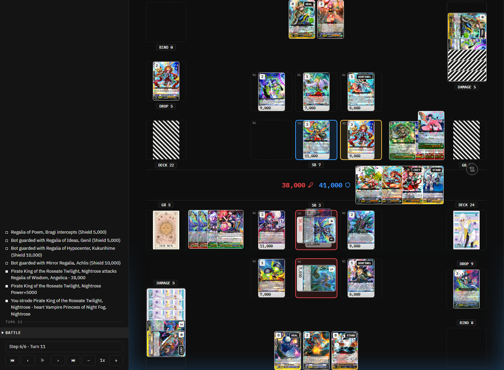

# Cardfight Vanguard Training

A web app for practicing Cardfight!! Vanguard (G era). Play a full game against a bot or a friend online, with every phase, trigger and card ability run by a rules engine, so you can learn the game, test a deck, and replay any turn step by step.

## Screenshots



## Features

- **Rules Engine**: Every phase, battle step and trigger of the G-era rules, including stride, G guardians, Generation Break and ultimate stride.
- **Card Abilities**: AUTO, ACT and CONT abilities run from code written in each card file, so a card plays exactly as printed.
- **Bot Opponent**: Counts the triggers left in the deck, reads lethal across the turn, and guards by expected cost.
- **Online Play**: Share a 6-digit room code with a friend; play again in the same room, and pick up where you left off after a reload.
- **Replays**: Step through any game, change the speed, and continue playing from any step.
- **Decks and Sleeves**: Build decks with the deck-building caps checked as you go, and pick sleeves for the main deck and the G zone.
- **Languages**: English and Japanese.

## Installation

1. **Clone the Repository**
   ```bash
   git clone https://github.com/NsamaX/Cardfight-Vanguard-Training.git
   ```

2. **Prerequisites**
   - Node.js (current LTS)
   - A Supabase project (optional): sign-in, card images, online play and cloud replays. Without it the app runs as a guest with the bundled cards and no images.

3. **Set Up**
   ```bash
   npm install
   ```

   For Supabase:
   1. Run the SQL files in `supabase/migrations/` in order, in the SQL Editor.
   2. Enable the Google provider under Authentication > Sign In / Providers (an OAuth client from Google Cloud Console with the redirect URI `https://<project-ref>.supabase.co/auth/v1/callback`), and add your site URLs under Authentication > URL Configuration.
   3. Copy `.env.example` to `.env` and fill in the Supabase URL and keys.
   4. Upload the default cards, decks and images: `npm run sync-defaults` (again whenever `content/` changes).

   To deploy on Vercel, set only the two `NEXT_PUBLIC_` variables there, and add the Vercel domain to the Supabase redirect URLs.

4. **Run**
   ```bash
   npm run dev
   ```
   Open http://localhost:3000. The bot plays the top side with the Genesis Regalia deck; press **Start** to begin.

## How to Play

| To | Click |
|----|-------|
| Mulligan | Hand cards to return → **Change** (none = **Confirm**) |
| Ride | Hand card → VC |
| Stride | In the stride step: G zone → a G unit → hand cards to discard (total grade 3+) → **Stride** |
| Call / move | Hand card → RC (main phase) / rear-guard → the other circle in its column |
| Use an ability | Yellow-bordered card → **Yes** / **No** |
| Attack | Your front-row unit (+ the grade 0–1 behind it to boost) → an opponent's front-row unit |
| Guard | Hand cards → **Yes**. Intercept: a front-row grade 2. G guardian: G zone → G guardian → a Heal in hand → **Yes** |
| Trigger | The trigger card on the battle bar → unit for Power+5000 → (Critical/Stand) unit for the second effect |
| Undo / redo | Arrows on the left of the middle bar |

The buttons at the bottom right open **Decks**, **Replays**, **Online** and **Settings** (language, bot level, first player, seed), and **Reset** starts a new game with the same decks.
